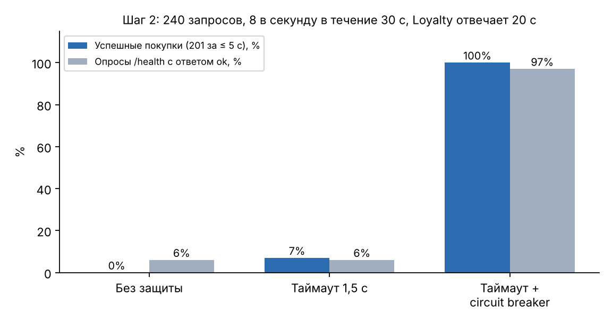

# 1. Цель работы

Пройти путь от «сломанного» синхронного взаимодействия к защищённому синхронному и далее к асинхронному на примере двух сервисов кинотеатра и зафиксировать на каждом шаге, какие проблемы возникают и какую цену приходится платить за их решение.

Задачи:

- воспроизвести потерю HTTP-ответа при уже выполненной операции (дубль билета и двойное начисление баллов) и устранить её ключом идемпотентности;
- воспроизвести каскадный отказ из-за медленной зависимости, сравнить без защиты, с таймаутом и с таймаутом плюс circuit breaker;
- перевести сценарий на события через RabbitMQ, показать развязку во времени и необходимость устойчивости к повторной доставке;
- связать наблюдения с материалом лекций: временная связанность, at-least-once доставка, конечная согласованность, защита вызывающей стороны.

# 2. Реализованное решение

Репозиторий поднимается командой `docker compose up --build`. Стек: Python 3.12, FastAPI, SQLite, httpx, pika, RabbitMQ (`rabbitmq:3-management`).

| Сервис | Порт | Роль |
|---|---|---|
| tickets | 8001 | `POST /tickets` (session_id, seat, customer_id), `GET /tickets`, `GET /health` |
| loyalty | 8002 | `POST /accrue` (синхронно), consumer очереди `loyalty.ticket_sold` (асинхронно), `GET /balance/{customer_id}` |
| rabbitmq | 5672, 15672 | брокер и панель управления, healthcheck, у сервисов `depends_on: service_healthy` |

Режимы переключаются переменными окружения (наборы лежат в `envs/`): `MODE=sync|async`, `LOYALTY_DELAY_MS` (1500 на шаге 1, 20000 на шаге 2), `LOYALTY_TIMEOUT_SEC` (1,5), `BREAKER_ENABLED`, `ACCRUAL_MODE=naive|idempotent`, `WORKER_THREADS=4`.

Ключевые решения:

- Вызов Loyalty выполняется до конца, даже если клиент оборвал соединение: токен отмены входящего запроса в HTTP-клиент не передаётся, а обработчик Tickets выполняется в потоке пула.
- Ограничение «не больше четырёх запросов одновременно» реализовано пулом из 4 потоков в одном процессе; `/health` обслуживается тем же пулом, поэтому при его исчерпании перестаёт отвечать (так каскадный отказ виден снаружи). Один процесс нужен, чтобы у всех потоков было общее состояние circuit breaker.
- Circuit breaker написан вручную (около 60 строк): CLOSED, OPEN, HALF_OPEN. Ошибка — таймаут, ошибка соединения или ответ 5xx. Порог — 5 ошибок подряд, интервал размыкания — 10 с, затем ровно один пробный вызов; успех замыкает, неудача снова размыкает на 10 с. Без трафика предохранитель сам не переходит из OPEN: состояние пересматривается только при очередном запросе.
- Обменник `cinema` (topic, durable), очередь `loyalty.ticket_sold` (именованная, durable, не exclusive, не auto-delete), сообщения `delivery_mode=2`, publisher confirms. Топология объявляется при старте Tickets и Loyalty (общий модуль `common/broker.py`), поэтому очередь существует до первой публикации. Loyalty делает ack только после записи начисления.

# 3. Шаг 1. Синхронная цепочка и дубликаты

Tickets сохраняет билет, затем синхронно вызывает Loyalty (задержка 1,5 с) и только после ответа возвращает 201. Проверки занятости места нет — иначе дубль не воспроизвести.

**Без ключа.** Запрос с лимитом клиента 1 с обрывается, когда билет уже сохранён, затем повторяется. Результат: два билета на место A1 и 100 баллов вместо 50.

```
=== A. Без ключа: запрос, обрыв клиента через 1 с, повтор ===
  -> клиент не получил ответ (таймаут 1 с)
  -> клиент не получил ответ (таймаут 1 с)
  билетов на место A1: 2; баллы клиента c-nokey: 100
21:18:14,296 Ticket saved ticket_id=7a1943b7-fe59-… seat=A1
21:18:15,314 Ticket saved ticket_id=af88fda0-eb1a-… seat=A1
```

**С `Idempotency-Key`.** Ключ резервируется в начале обработки (`INSERT … ON CONFLICT DO NOTHING`, статус `processing`), по завершении сохраняется ответ (статус `done`). Повтор, пришедший пока первый запрос ещё выполняется, получает `409 Conflict` с `Retry-After: 2`; повтор после завершения получает сохранённый ответ (заголовок `Idempotent-Replay: true`) без новых билетов и начислений.

```
=== B. С Idempotency-Key: тот же сценарий ===
  -> клиент не получил ответ (таймаут 1 с)
  повтор, пока первый запрос ещё выполняется:   -> HTTP 409
  повтор после завершения первого:              -> HTTP 201 {"ticket_id":"bb8dc365-…","seat":"B2",…}
  билетов на место B2: 1; баллы клиента c-key: 50
```

Ограничение: если процесс Tickets упадёт между резервированием ключа и сохранением результата, ключ останется в статусе `processing` и клиент будет получать 409. В промышленном решении у такой записи есть срок жизни; в рамках задания это не реализовано.

# 4. Шаг 2. Каскадный отказ

Loyalty замедлен до 20 с, Tickets обрабатывает не больше 4 запросов одновременно. Нагрузка: 8 запросов в секунду в течение 30 с (240 запросов, у каждого свой `Idempotency-Key`), параллельно раз в секунду опрашивается `GET /health`. Успех — ответ 201 не позже чем за 5 с. Одна и та же нагрузка подавалась во всех трёх состояниях, перед каждым прогоном стек пересоздавался.

| Состояние | Успешных покупок | p50 / p95 ответа среди 201 | /health с ответом ok |
|---|---|---|---|
| Без защиты | 0 из 240 (0%) | ответов 201 нет, все 240 по таймауту клиента | 1 из 18 |
| Таймаут 1,5 с | 16 из 240 (7%) | 3618 мс / 4706 мс | 1 из 18 |
| Таймаут 1,5 с + circuit breaker | 240 из 240 (100%) | 39 мс / 1582 мс | 28 из 29 |



**Что закончилось.** Рабочие места Tickets. Без защиты каждый вызов Loyalty занимает один из четырёх потоков на 20 с; остальные запросы ждут в очереди и за 5 с не получают ответа. `/health` стоит в той же очереди и тоже не отвечает: сервис исправен, но в целом перестал работать.

**Почему таймаута мало.** Таймаут освобождает поток через 1,5 с, но каждый запрос всё равно сначала упирается в 1,5-секундное ожидание. Пропускная способность: 4 потока / 1,5 с ≈ 2,7 запроса в секунду при входящих 8. Очередь растёт, и успевают только первые запросы (16 из 240). Заказ сохраняется и клиент получает 201, когда таймаут сработал, а в лог пишется ошибка:

```
WARNING tickets: Failed to accrue points for ticket_id=91be868d-…: ReadTimeout('timed out')
```

**Почему помогает breaker.** После пяти таймаутов подряд предохранитель размыкается, и следующие запросы завершаются за миллисекунды без сетевого вызова (пропускная способность определяется только записью в БД). Лог из прогона:

```
21:22:43 CLOSED -> OPEN (5 consecutive failures, open for 10s)
21:22:43 Circuit is OPEN: Loyalty call skipped for ticket_id=5c174266-…
21:22:53 OPEN -> HALF_OPEN (10s passed, letting one probe call through)
21:22:54 HALF_OPEN -> OPEN (probe call failed, open for 10s more)
```

Хвост p95 = 1582 мс — это первые запросы до размыкания (пять таймаутов по 1,5 с) и пробные вызовы.

**Жизненный цикл предохранителя.** Loyalty исправен, нагрузка 6 запросов в секунду в течение 80 с. На 10-й секунде Loyalty остановлен: за несколько секунд предохранитель разомкнулся. Пока Loyalty выключен, пробные вызовы падают и возвращают предохранитель в OPEN. После запуска Loyalty первый же пробный вызов успешен, предохранитель замыкается. Итог прогона: 457 успешных из 480 (95%), 23 запроса не уложились в 5 с (они пришлись на первые секунды после остановки Loyalty, пока предохранитель набирал пять ошибок подряд, и `/health` в это время трижды не ответил), `/health` отвечал 74 раза из 77.

```
21:24:11 CLOSED -> OPEN (5 consecutive failures, open for 10s)     Loyalty остановлен
21:24:21 OPEN -> HALF_OPEN (10s passed, letting one probe call through)
21:24:29 HALF_OPEN -> OPEN (probe call failed, open for 10s more)  Loyalty ещё остановлен
21:24:39 OPEN -> HALF_OPEN (10s passed, letting one probe call through)
21:24:39 HALF_OPEN -> CLOSED (probe call succeeded)                Loyalty запущен
```

**Цена.** Пока предохранитель разомкнут, начисления не выполняются (в лог пишется «call skipped»). Билеты продаются, но баллы по ним пропадают, если их не добрать отдельным процессом. Это и мотивирует шаг 3.

# 5. Шаг 3. Перевод на события

Синхронный вызов убран. Tickets сохраняет билет, публикует `TicketSold` (с `message_id`, `delivery_mode=2`) в обменник `cinema` и сразу возвращает 201. Loyalty читает очередь `loyalty.ticket_sold` и подтверждает сообщение после записи начисления.

**Развязка во времени.** Loyalty полностью остановлен, продано три билета: все продажи прошли за десятки миллисекунд, три события лежат в очереди (`durable=true`, `auto_delete=false`, `exclusive=false`). После запуска Loyalty очередь опустела, баллы начислены задним числом.

```
билет A1 (c-a1): HTTP 201 за 82 мс  {"ticket_id":"b4a4278a-…","seat":"A1","loyalty":"queued"}
билет A2 (c-a2): HTTP 201 за 48 мс
билет A3 (c-a3): HTTP 201 за 39 мс
loyalty.ticket_sold  messages_ready=3  messages_unacknowledged=0  durable=true auto_delete=false exclusive=false
--- Loyalty запущен ---
loyalty.ticket_sold  messages_ready=0
клиент c-a1: 50 баллов;  c-a2: 50 баллов;  c-a3: 50 баллов
```

**Повторная доставка при «прибавить баллы».** Одно событие с одним и тем же `message_id` опубликовано дважды: баллы удвоились.

```
published TicketSold message_id=m-dup-1 ticket_id=ticket-dup-1 x2
клиент c-dup: счётчик «прибавить» = 100        (ожидалось 50)
```

**Естественно идемпотентное начисление.** Начисление записывается как строка таблицы `accruals` с первичным ключом `ticket_id`: `INSERT … ON CONFLICT (ticket_id) DO NOTHING`. Баланс считается как `SUM(points)` по записям, а не как отдельный счётчик. Таблица обработанных сообщений не нужна.

```
published TicketSold message_id=m-dup-2 ticket_id=ticket-dup-2 x2
клиент c-dup2: сумма по записям начислений = 50 (записей: 1)
Accrued 50 points to customer=c-dup2 for ticket=ticket-dup-2 message_id=m-dup-2
Duplicate event ignored: ticket_id=ticket-dup-2 message_id=m-dup-2 (already accrued)
```

# 6. Ответы на вопросы

Ответы на четыре вопроса варианта 2 с короткими фрагментами логов приведены в файле `REPORT.md` в корне репозитория.

**1. Что вы увидели на шаге 1 и почему повтор создал второй билет и второе начисление?** Билет и начисление выполнились на сервере, а ответ до клиента не дошёл. Клиент не может отличить «операция не выполнена» от «операция выполнена, ответ потерян» и повторяет запрос. Без ключа повтор — новая операция: проверки места нет, и появляются второй билет и второе начисление. Это следствие того, что сеть ненадёжна, а POST не идемпотентен. Ключ превращает повтор в запрос, на который возвращается прежний ответ.

**2. Какой ресурс закончился на шаге 2 и почему circuit breaker защитил лучше таймаута?** Закончились рабочие потоки Tickets. Таймаут ограничивает время удержания потока (1,5 с), но не число обращений к мёртвой зависимости: пропускная способность остаётся около 2,7 запроса в секунду при 8 входящих. Breaker прекращает обращения: запрос завершается за миллисекунды, потоки свободны, `/health` отвечает. Цена — пропавшие начисления на время, пока предохранитель разомкнут.

**3. Что изменилось для клиента после перехода на события и какая цена?** Клиент получает 201 за десятки миллисекунд независимо от состояния Loyalty. Цена: конечная согласованность, отсутствие подтверждения начисления, доставка at-least-once (дубли — штатный режим), сложнее отладка и проблема двойной записи (билет сохранён, а публикация события может не состояться; решение — Transactional Outbox, см. лекцию 2).

**4. Почему «прибавить баллы» опасно, почему запись с уникальным `ticket_id` проще таблицы дедупликации и почему не нужна транзакция на две записи?** «Прибавить» не идемпотентно: повторное получение события увеличивает баланс снова (100 вместо 50). Запись начисления с первичным ключом `ticket_id` объединяет результат операции и отметку о ней в одной строке: дедупликация обеспечивается ограничением уникальности, а `ON CONFLICT DO NOTHING` атомарен. Писать надо ровно одну строку, поэтому транзакция на две записи (как у `processed_messages`) не нужна.

# 7. Выводы

- Идемпотентность нужна на любой операции, которую клиент может безопасно повторить; ключ идемпотентности должен резервироваться до начала обработки.
- Таймаут — обязательный минимум для любого синхронного вызова; без него медленная зависимость выводит из строя вызывающий сервис. Circuit breaker добавляет защиту от лишних обращений к деградировавшему сервису.
- Асинхронное взаимодействие убирает временную связанность, но заменяет немедленную согласованность конечной и делает дубли нормой, поэтому обработчик обязан быть идемпотентным.

Репозиторий с кодом и скриптами прогонов: https://github.com/<логин>/cinema-system
